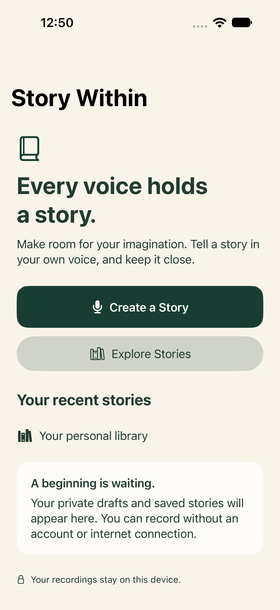
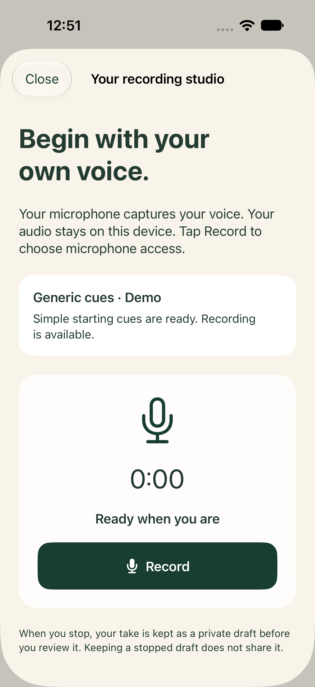
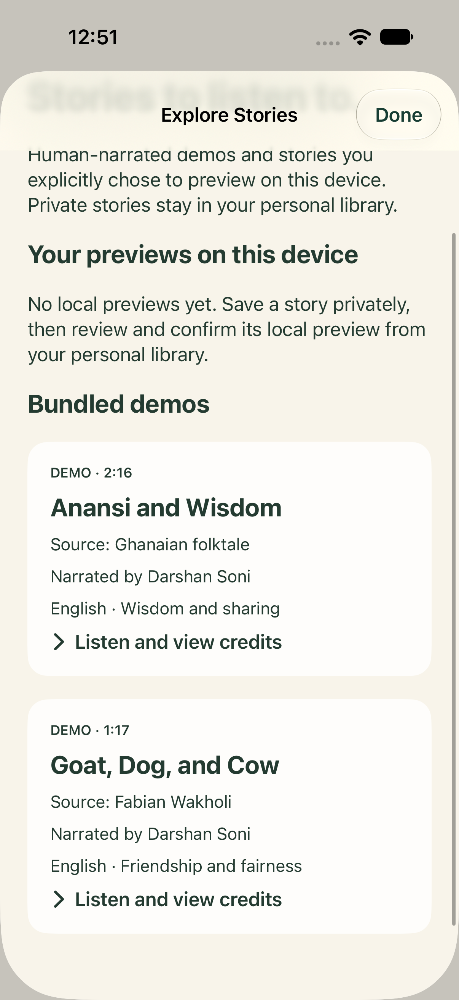

<div align="center">

# Story Within

### Every voice holds a story.

A space for parents to imagine, tell, and keep stories in their own voices.

**SwiftUI · Swift · iOS 27 · Apple on-device intelligence**

Built for the **OpenAI × Andela African Storytelling Capstone**.

</div>

---

## The parent is the storyteller

Story Within starts with a parent's idea, memory, or their child's interests. A gentle AI coach offers a little guidance and an optional question. The parent chooses the direction, tells the story, and keeps the original recording.

The current MVP runs natively on iPhone, with real audio recording and English coaching through Apple's on-device Foundation Models framework. No backend account, API key, or third-party dependency is required.

## A look inside

<table>
  <tr>
    <td align="center"></td>
    <td align="center"></td>
    <td align="center"></td>
  </tr>
  <tr>
    <td align="center"><strong>Begin with you</strong></td>
    <td align="center"><strong>Tell it in your voice</strong></td>
    <td align="center"><strong>Listen and discover</strong></td>
  </tr>
</table>

*Actual app screens captured on an iOS 27 simulator. Live on-device coaching was separately verified on an iPhone 15 Pro.*

## What works today

| Experience | In the MVP |
| --- | --- |
| Find a starting point | Begin with an idea or your listener's interests. Accept, answer, or skip coaching questions. |
| Get gentle coaching | Short English guidance and prepared text cues from Apple's on-device model when available. Clearly labeled demo coaching otherwise. |
| Record a real story | Capture microphone audio, pause and resume the same take, and stop to review. |
| Ask for inspiration | Pause, choose a cue, and resume when ready. The coach does not listen to or narrate your recording. |
| Keep and revisit | Save privately, edit story details or manual text, reopen recordings, and manage your personal library. |
| Explore stories | Play bundled human-narrated stories with source and license credits. |
| Review a local preview | Explicitly confirm or withdraw a preview visible on this device only. |

## Try the story journey

1. Choose **Create a Story → Start with an idea**.
2. Enter a spark, such as *A patient tortoise in a city garden*, then choose **Explore this together**.
3. Follow your own direction and choose **Start Recording → Record**.
4. Tell your story. Try **Pause for inspiration → Show a cue → Resume recording**.
5. **Stop and review**, give it a title, and **Save privately**.
6. Reopen it from Home or your personal library and press **Play**.

If cue preparation is taking too long, **Record without waiting** continues with clearly labeled generic cues.

## Run locally

**Development baseline:** Xcode 27.1, the iOS 27 SDK, and an iOS 27 device or simulator. The demo has been verified on an iPhone 15 Pro running iOS 27.0.1.

```sh
git clone git@github.com:octiv-fortune/story-within.git
cd story-within
open StoryWithin.xcodeproj
```

Select the **StoryWithin** scheme and a destination, then run. For a physical iPhone, select your own development team under **Signing & Capabilities** and allow microphone access when you first record. There are no packages to install or environment secrets to configure.

For live coaching, Apple Intelligence must be enabled and its English model ready on an eligible device. The app checks availability and displays the selected provider. Reopen the app after enabling or preparing the system model. Simulator model availability varies; recording, storage, and explicitly labeled demo coaching can be exercised without a ready model. An error from a selected live provider is shown with retry options rather than silently presented as a demo response.

## Built with Apple's native tools

```text
SwiftUI screens
    └── StoryWorkflow
        ├── StoryCoachService → on-device model / deterministic demo
        ├── NativeStoryAudio  → AVFoundation recording and playback
        └── SwiftData        → story metadata + local recording files
```

The coaching interface keeps model behavior separate from the story workflow. Model requests use a bounded excerpt of the parent's text. Conversation and listener preferences stay in the current session; recordings and saved story details stay on this device. Prepared cues are text, with no model requests during microphone capture.

## Verification

The current iOS 27 MVP passed **76 deterministic tests**, Debug simulator and Release iOS builds, and an in-place signed installation on the demo phone. Device walkthroughs confirmed real recording, pause/resume, save/reopen/playback, interruption recovery, and local-preview review and withdrawal. The user also confirmed actual on-device English coaching on the iPhone 15 Pro.

Run deterministic checks on an available iOS 27 simulator:

```sh
xcodebuild test \
  -project StoryWithin.xcodeproj \
  -scheme StoryWithin \
  -destination 'platform=iOS Simulator,id=YOUR_SIMULATOR_UDID' \
  -skip-testing:StoryWithinTests/NativeCoachingAvailabilityTests/testActualNativeEnglishGenerationWhenModelIsReady \
  CODE_SIGNING_ALLOWED=NO
```

The actual-generation test is separate and requires a working system model. Deterministic tests do not establish model quality or real microphone behavior. See the [verification evidence](.scratch/story-within-mvp/evidence/apple-coach.md) for results and limitations.

## MVP scope and next steps

This is a focused iPhone demo, with **English coaching and local storage**. Automatic transcription, isiZulu/isiXhosa translation, reviewed language quality, cloud sync, and publishing to other people are future work. Community preview currently means this device only. Broader accessibility validation was deferred for the demo.

The current coach uses Apple's model. The capstone context does not imply an OpenAI API integration in this build.

- [Product brief](docs/agents/product-brief.md)
- [Implementation specification](.scratch/story-within-mvp/spec.md)
- [Implementation record](.scratch/story-within-mvp/implementation.md)
- [GitHub issues](https://github.com/octiv-fortune/story-within/issues)

## Story credits

The bundled English recordings are human narrations by **Darshan Soni**, sourced from **Storybooks Canada**, with story content from **African Storybook**. They are licensed under **CC BY 3.0** and are distinct from parent recordings. Full source, author, production, and license details are in [the recording credits](StoryWithin/DemoStories/ATTRIBUTION.md) and inside the app.
